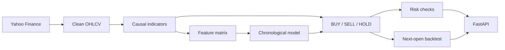

# AI-Powered Forex Market Analysis & Trading System

A research stack for major FX pairs: historical candles, causal indicators, a leakage-aware direction model, deterministic BUY / SELL / HOLD signals, position-size checks, and an event-driven backtest. FastAPI exposes each piece for inspection.

> **Research boundary:** This project is for research, education, and paper analysis. It does not connect to a broker, does not place orders, and is not financial advice. A signal score is not a probability of profit.

## What was delivered

- Seven majors from Yahoo Finance, normalized to OHLCV and cached locally: EURUSD, GBPUSD, USDJPY, AUDUSD, USDCAD, USDCHF, NZDUSD.
- Causal indicators with tests against hand-calculated values: SMA, EMA, Wilder RSI, MACD, Wilder ATR, Bollinger Bands, rolling volatility, and trailing support and resistance.
- A next-bar up/down classifier. Rows stay in time order. The split is 70% train, 15% validation, 15% test, with one embargo row so the last training label cannot see the first test close.
- Logistic regression as the interpretable baseline. A shallow random forest is compared on validation ROC-AUC and does not replace the baseline on a tie.
- A signal engine that requires the technical score and the model to agree. Disagreement is HOLD.
- A risk check that rejects a non-positive balance, a zero stop, a target on the wrong side, risk above 2%, drawdown already at 20%, or leverage above 30.
- A backtest that reads the signal at the close of bar `t` and fills at the open of bar `t+1`. Costs are charged against the trader. If stop and target both trade in the same bar, the stop fills.
- An API that rejects unknown fields and loads a model only from the configured path. It will not unpickle a file supplied by the caller.
- Automated checks: 37 pytest cases on synthetic candles, Ruff, a non-root Docker image, and GitHub Actions.

Run the backtest command below to generate the current sample. This page does not publish a profit claim.

## Problem

A market project often mixes three different questions:

- Did the next candle close higher?
- Did a rule make money after costs?
- Should an account take this trade?

Those questions live in separate modules. The classifier answers only the first. The backtest answers the second under the assumptions it returns with every result. The risk manager answers a sizing question and can reject the trade. None of them is a broker.

## Architecture



Each box is a package under `src/forex_ai/`. The API calls the library. It does not own the formulas.

## Features

- Daily, hourly, and weekly history for the periods `1mo` through `max`
- SMA, EMA, RSI, MACD, ATR, Bollinger Bands, volatility, support, and resistance
- An explicit feature list. The label is the only column that reads the next close
- BUY at a technical score of at least 0.62, SELL at 0.38 or below, otherwise HOLD
- Default risk of 1% of balance and a minimum reward-to-risk of 1.5
- Spread and slippage assumptions of 1.0 pip and 0.5 pip, applied on entry and exit
- Routes for health, candles, indicators, signals, prediction, and backtest

## How the research stays honest

- Indicator windows end at the current bar. Leading values stay missing until the window is full.
- Lags use past bars only. Unsorted or duplicate timestamps raise instead of being shuffled.
- The scaler is fit on training rows, then the chosen model is refit on train plus validation. The test slice is scored once.
- Confidence near 1 is a bullish score and confidence near 0 is a bearish score. It is not the chance of making money.
- `/predict` reports whether the scored bar was already inside the fit window.

## Repository structure

```text
src/forex_ai/          Data, indicators, model, signals, risk, backtest, API
scripts/               Download, train, and backtest commands
tests/                 Synthetic-candle tests
data/                  Local cache, gitignored except the placeholder
models/                Saved model bundle, gitignored except the placeholder
```

## Local setup

```bash
git clone https://github.com/vanshviggg/forex-ai-trading-system.git
cd forex-ai-trading-system
python3.12 -m venv .venv
source .venv/bin/activate
python -m pip install -e '.[dev]'
cp .env.example .env
```

`.env` is optional. No API key is required. Do not commit a real `.env`.

## Usage

```bash
python scripts/download_data.py --symbol EURUSD --period 2y --interval 1d
python scripts/train_model.py --symbol EURUSD --period 2y --interval 1d
python scripts/run_backtest.py --symbol EURUSD --period 2y --interval 1d
python scripts/run_backtest.py --symbol EURUSD --period 2y --interval 1d --use-ml
uvicorn forex_ai.api.main:app --reload
```

- Dashboard docs: `http://127.0.0.1:8000/docs`
- The backtest writes `data/backtest_EURUSD_2y_1d.json`, or the `_ml` variant. The file includes metrics, trades, the equity curve, and the assumptions used for that run.
- Training compares logistic regression with a random forest unless you pass `--no-random-forest`.

## API

| Method | Path | Purpose |
| --- | --- | --- |
| GET | `/health` | Process is up |
| GET | `/market/{symbol}` | Recent candles and data-source limits |
| GET | `/indicators/{symbol}` | Latest causal indicators |
| GET | `/signal/{symbol}` | Technical BUY / SELL / HOLD |
| POST | `/predict` | Up/down probabilities from the saved model |
| POST | `/backtest` | Historical simulation. `use_ml` keeps the model on the held-out slice |

Unknown symbols, bad periods, and non-positive capital return 422. A missing model returns 404. A Yahoo failure returns 502.

## Tests

```bash
ruff check src tests scripts
pytest
```

The tests use synthetic candles. They check formulas, leakage, sizing, and fills. They do not assert that the model is profitable.

## Docker

```bash
docker compose up --build
```

The image listens on port 8000 and runs as `appuser`. Mounted `data/` and `models/` directories persist a cache and a model trained on the host. `/health` does not need a model. `/predict` does.

## Limitations

- Yahoo Finance FX data can gap, revise, and has no usable bid/ask. Volume is not a model feature. Costs are a fixed pip assumption.
- One chronological split is not walk-forward validation.
- The label is the next close. The backtest can hold until a stop, a target, or an opposite signal.
- Raw moving-average levels are non-stationary. Scaling does not fix that.
- Sharpe uses a zero risk-free rate and is undefined on a flat equity curve.
- There is no portfolio, rollover, news filter, or execution venue.

## Disclaimer

Past classification metrics and one historical simulation are not evidence that a rule will make money. Read the assumptions returned with each backtest before quoting a number.
